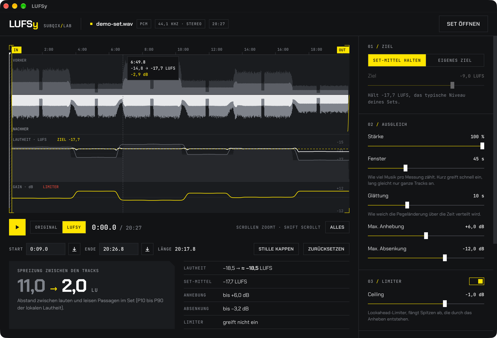
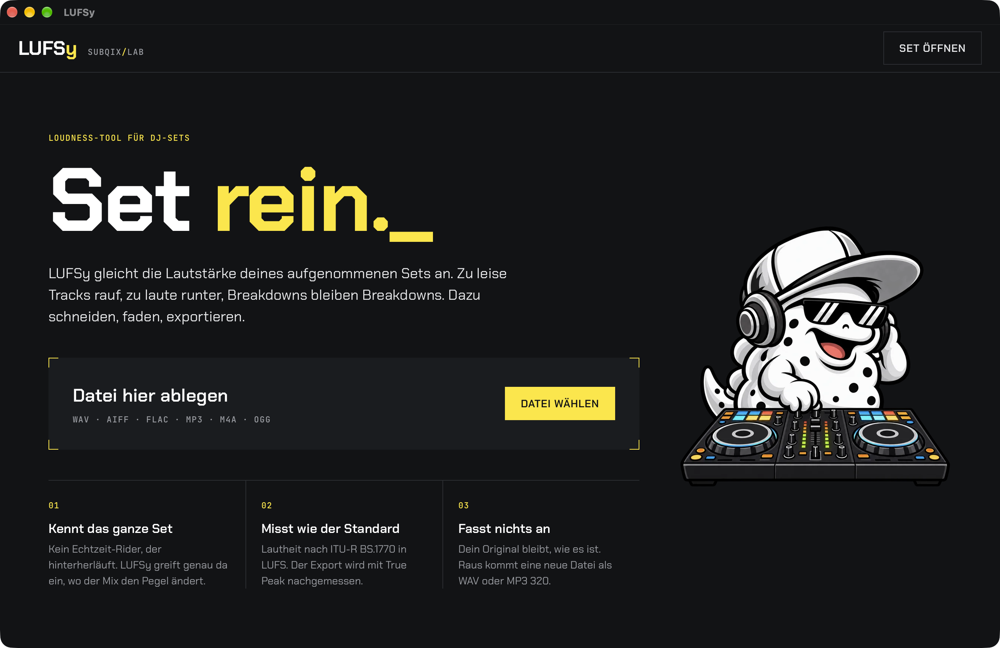
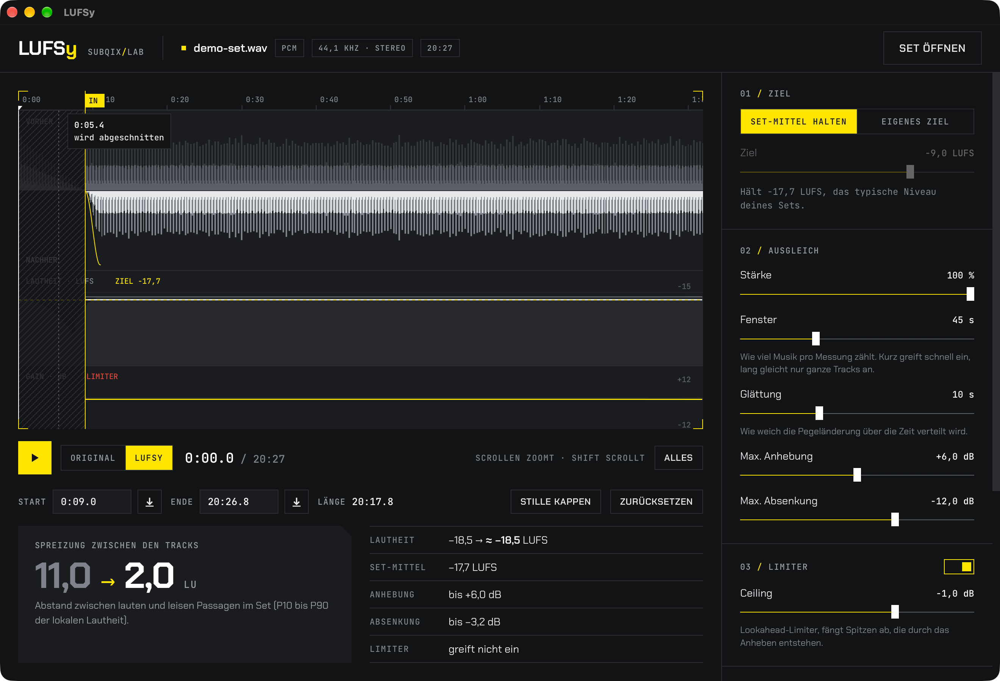

<p align="center">
  <picture>
    <source media="(prefers-color-scheme: dark)" srcset="assets/branding/lufsy-lockup-dark.svg">
    
  </picture>
</p>

<p align="center">
  <strong>Even out a recorded DJ set.</strong><br>
  LUFSy finds the tracks that came out too loud or too quiet and brings them to one level,<br>
  then trims the recording and fades it in and out.
</p>

<p align="center">
  <a href="https://github.com/BTFLV/LUFSy/releases/latest"></a>
  <a href="https://github.com/BTFLV/LUFSy/actions/workflows/ci.yml"></a>
  
  
  <a href="LICENSE"></a>
</p>

<p align="center">
  
</p>

## Highlights

- **Knows the whole set.** A live level rider only hears the past and reacts
  late. LUFSy reads the recording first, so every gain change sits exactly
  where the mix changes level, with nothing to catch up on.
- **Breakdowns stay breakdowns.** The level of each moment is measured from the
  loud part of its surroundings, so intentionally quiet passages are not pulled
  up to drop level.
- **Measured like the standard.** Loudness follows ITU-R BS.1770 (K-weighting,
  gated integration) and is reported in LUFS. Every export is measured again
  with an independent EBU R128 meter, including true peak.
- **Cut and fade in one go.** Drag the IN and OUT handles to drop the previous
  DJ's tail or the next one's intro, then set fade-in and fade-out length and
  curve.
- **Hear it first.** Play the set and switch between Original and LUFSy at any
  point. The preview follows the same gain curve as the export.
- **Fast.** A two-hour set is analysed in seconds; WAV export runs at roughly
  400× real time, MP3 at about 80× on an Apple M-series machine.

## Download

Get the latest build from
[**Releases**](https://github.com/BTFLV/LUFSy/releases/latest):

| System | File |
| --- | --- |
| Apple Silicon (arm64), macOS 11 or newer | `LUFSy-<version>-macOS-arm64.dmg` |
| Windows 10/11, 64-bit | `LUFSy-<version>-Windows-x64-setup.exe` |

The builds are not signed yet, so both systems will ask once:

- **macOS:** drag LUFSy to Applications. If macOS says the app is damaged or
  cannot be checked, run `xattr -dr com.apple.quarantine /Applications/LUFSy.app`
  once, or allow it under System Settings → Privacy & Security.
- **Windows:** SmartScreen may show "Windows protected your PC". Click
  *More info* → *Run anyway*.

LUFSy reads WAV, AIFF, FLAC, MP3, M4A/AAC and Ogg Vorbis and writes WAV
(16-bit with TPDF dither, 24-bit, 32-bit float) or MP3 320 kbit/s. The
original file is never changed.

## Using it

1. **Open the set.** Drop the file on the window or click *Set öffnen*. The
   interface is in German.
2. **Look at the curves.** The top half of the waveform is the recording, the
   bottom half the result. Below it the local loudness before (grey) and after
   (white) against the target (yellow, dashed), and the gain LUFSy applies.
3. **Cut.** Drag the yellow IN and OUT handles, type a time, or press `I` and
   `O` at the playhead. *Stille kappen* trims leading and trailing silence.
4. **Listen.** Space plays from the playhead, `A` switches between Original and
   LUFSy, the arrow keys jump 5 s (with Shift 30 s). Scroll to zoom, Shift+scroll
   or drag to move.
5. **Export.** Pick a format and click *Exportieren*. The result shows the
   measured loudness, true peak and loudness range of the file.

<table>
  <tr>
    <td width="50%"></td>
    <td width="50%"></td>
  </tr>
  <tr>
    <td>Drop a recording on the window to start.</td>
    <td>Zoomed in on IN: the previous DJ's tail is cut away, the fade-in drawn over the result.</td>
  </tr>
</table>

| Control | Default | What it does |
| --- | --- | --- |
| Ziel | Set-Mittel halten | Keep the set's typical level, or move the whole set to a fixed loudness (−20 to −5 LUFS) |
| Stärke | 100 % | How much of each deviation is corrected |
| Fenster | 45 s | How much music counts for one measurement. Short reacts within a track, long only evens out whole tracks |
| Glättung | 10 s | How gently the gain moves from one level to the next |
| Max. Anhebung / Absenkung | +6 / −12 dB | Limits for raising quiet and lowering loud passages |
| Limiter, Ceiling | on, −1.0 dB | Stereo-linked lookahead limiter for peaks created by raising the level |
| Fade-in / Fade-out | 2 s / 6 s | Fade length at IN and OUT; curve linear, smooth (S) or logarithmic |

Double-click a slider to reset it, click its value to type one. Settings are
remembered between sessions.

## How it works

Analysis decodes the file once and reduces it to 100 ms blocks of K-weighted
energy, sample peak and RMS. Everything after that works on these blocks, so
moving a slider recomputes the plan in milliseconds.

For every half second LUFSy takes the 3 s short-term loudness values inside the
window around it and averages the loudest 30 %. That is the local level of the
music, largely unaffected by breakdowns, intros and silence. The median of these
levels is the set's typical level. Each moment is corrected towards it (scaled
by *Stärke*, limited by the maximum raise and cut), and the correction is
smoothed with a zero-phase filter, so it never lags behind the music. Mostly
silent stretches hold their gain instead of being raised.

Rendering decodes the file a second time, applies the gain curve per sample,
runs the lookahead limiter (2 ms lookahead, 80 ms release, guaranteed to stay
under the ceiling), applies the fades and encodes. An EBU R128 meter measures
the result on the way out. Details and the reasoning behind the numbers are in
[docs/how-it-works.md](docs/how-it-works.md).

LUFSy grew out of [Vibaliza](https://github.com/BTFLV/Vibaliza), a real-time
level rider on an ESP32-S3. The idea is the same; knowing the whole recording
removes the compromises a real-time rider has to make.

## Building from source

Requirements: Rust (stable), Node.js 20 or newer, and the
[Tauri prerequisites](https://tauri.app/start/prerequisites/) for your system
(Xcode Command Line Tools on macOS, the MSVC build tools and WebView2 on
Windows).

```sh
git clone https://github.com/BTFLV/LUFSy.git
cd LUFSy
npm install
npm run dev      # run with live reload of the Rust side
npm run build    # installer in src-tauri/target/release/bundle
```

The frontend is plain HTML, CSS and JavaScript in `src/`; there is no bundler.
The DSP lives in `src-tauri/src/` and also runs without the UI:

```sh
cd src-tauri
cargo run --release --example demo_set -- demo-set.wav 20   # synthetic 20-minute set
cargo run --release --example cli -- demo-set.wav out.wav wav24
```

`demo_set` writes six tracks at uneven levels with breakdowns and the previous
DJ's last bars in front; it is the file in the screenshots. `cli` runs analysis,
planning and export and measures the result again.

## Tests

```sh
cd src-tauri && cargo test --release
```

The tests check the loudness measurement against a −20 dBFS 1 kHz sine at 44.1,
48 and 96 kHz, that the limiter never exceeds its ceiling (including
single-sample spikes) and passes quiet material unchanged, that the planner
levels tracks, respects its limits, strength and target, and that a full render
cuts, fades and levels correctly in WAV 16, WAV 24 and MP3. CI runs them on
macOS and Windows for every push.

## Releases

Pushing a tag `vX.Y.Z` that matches the version in `src-tauri/tauri.conf.json`
builds the macOS disk image for Apple Silicon (arm64) and the Windows installer and publishes a
GitHub release with notes from [CHANGELOG.md](CHANGELOG.md) and a
`SHA256SUMS.txt`. Builds are currently not code-signed.

## License

LUFSy is released under the [MIT License](LICENSE). It is built with
[Tauri](https://tauri.app), [Symphonia](https://github.com/pdeljanov/Symphonia),
[ebur128](https://github.com/sdroege/ebur128), [hound](https://github.com/ruuda/hound)
and [LAME](https://lame.sourceforge.io) via
[mp3lame-encoder](https://github.com/DoumanAsh/mp3lame-encoder), and uses the
Chakra Petch and JetBrains Mono typefaces; their licenses are listed in
[THIRD_PARTY_NOTICES.txt](assets/THIRD_PARTY_NOTICES.txt). The subqix name,
logo and the nugQIX mascot are not covered by the MIT License.
