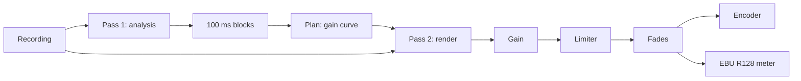

# How LUFSy works

LUFSy is two passes over the recording with a planning step in between.



Nothing holds the whole file in memory. A two-hour 48 kHz set is about
2.7 GB as float samples; the analysis of the same set is 72,000 blocks.

## Pass 1: analysis (`analysis.rs`)

The decoder (`decode.rs`, Symphonia) delivers interleaved stereo; mono is
duplicated to both sides, files with more channels keep L and R. Each channel
runs through the BS.1770 K-weighting filter (`kweight.rs`: high shelf at
1.68 kHz, high-pass at 38 Hz, coefficients derived for the file's own sample
rate). For every 100 ms block LUFSy stores

- the K-weighted mean square, summed over both channels,
- the sample peak,
- the unweighted RMS (for drawing only).

From these blocks:

- **Integrated loudness** uses 400 ms gating blocks with 75 % overlap (four
  consecutive 100 ms blocks), the −70 LUFS absolute gate and the −10 LU
  relative gate of BS.1770-4. A −20 dBFS 1 kHz sine on both channels reads
  −20.0 LUFS; the tests check this at 44.1, 48 and 96 kHz.
- **Short-term loudness** is the mean over 3 s (30 blocks) centred on each
  block.

## Planning (`plan.rs`)

The plan is computed for the cut range only, so material that will be cut
away (the previous DJ, the room after the set) never influences the levels.

### Local level

Every 0.5 s LUFSy looks at the short-term values inside the window centred on
that point (*Fenster*, default 45 s). Values below −45 LUFS are ignored. If
less than a fifth of the window is above that, the point counts as silent.
Otherwise the local level is the energy mean of the loudest 30 % of the
remaining values.

Why the loudest 30 %? In club music the loudness that matters is the loudness
of the main part of a track. Breakdowns and intros are quieter on purpose; a
plain average over the window would pull them up and flatten the dynamics of
every track. With the top-30 % estimate a breakdown only moves the level once
it fills most of the window, which a 45 s window rarely allows.

Silent points take their level by interpolating between the measured
neighbours, so a pause in the set neither gets raised nor makes the gain jump.

### Correction

The **reference** is the median of all measured local levels: the set's
typical level. For each point

```text
correction = clamp(strength × (reference − level), −max_cut, +max_boost)
gain       = correction + (target − reference)
```

With *Set-Mittel halten* the target is the reference and only the deviations
are corrected. With a fixed target the whole set moves on top of that, so
*Stärke* only scales the evening-out, never the overall shift.

### Smoothing

The correction is smoothed with two passes of a centred moving average of
length *Glättung* (default 10 s), which is close to a triangular filter. It is
centred, so it is zero-phase: a level change begins as far before a transition
as it ends after it. A real-time rider can only begin after the change.

The plan is then interpolated from 0.5 s points back to 100 ms blocks. The UI
also shows the local level before and after, the integrated loudness before
and (estimated) after, the spread of the local level (P90 − P10, in LU) and
how often the limiter will have to work, estimated from block peaks.

## Pass 2: render (`render.rs`)

The file is decoded again. Frames before IN and after OUT are dropped. The
gain is converted to linear at each block centre and interpolated linearly
per sample.

### Limiter (`limiter.rs`)

For every sample the limiter computes the gain `r` that would keep the louder
channel at the ceiling. It then

1. takes the minimum of `r` over a window of ±L samples (monotonic deque),
2. averages those minima over another ±L samples,
3. applies a release of 80 ms when the gain goes back up.

Every average in step 2 consists only of minima that already include the
sample in the middle, so the envelope is at or below `r` at every sample. The
ceiling can not be exceeded, and the gain curve has no corners. L is 1 ms, so
the lookahead is 2 ms and the latency 2 ms, which is compensated. Material
that stays under the ceiling passes bit-identical.

The limiter works on sample peaks. True peak is measured afterwards; with a
−1 dB ceiling it typically lands a few tenths of a dB higher.

### Fades and output

Fades are applied after the limiter, so they only make things quieter:

| Curve | Gain at position x (0 → 1) |
| --- | --- |
| Linear | x |
| Weich | ½ − ½·cos(πx) |
| Log | 60 dB straight line in decibels, pinned to exactly 0 at x = 0 |

WAV 16-bit adds TPDF dither, 24-bit is rounded, 32-bit float is written as is.
MP3 uses LAME at 320 kbit/s CBR with quality 2; LAME supports at most 48 kHz,
higher sample rates have to be exported as WAV.

The same output samples go to an EBU R128 meter (`ebur128` crate) for the
report: integrated loudness, true peak (4× oversampled) and loudness range.

## Preview

The preview plays the original file through the WebView's audio element and a
Web Audio gain node. The gain follows the same plan and fades as the export.
A soft clipper stands in for the limiter, so the preview is close but not
sample-exact; the export is.

## Performance

On an Apple M-series machine, for a 20-minute 44.1 kHz set: analysis 0.4 s,
planning 3 ms, WAV export 2.8 s, MP3 export 15 s (all including the R128
measurement). Times scale linearly with length.
